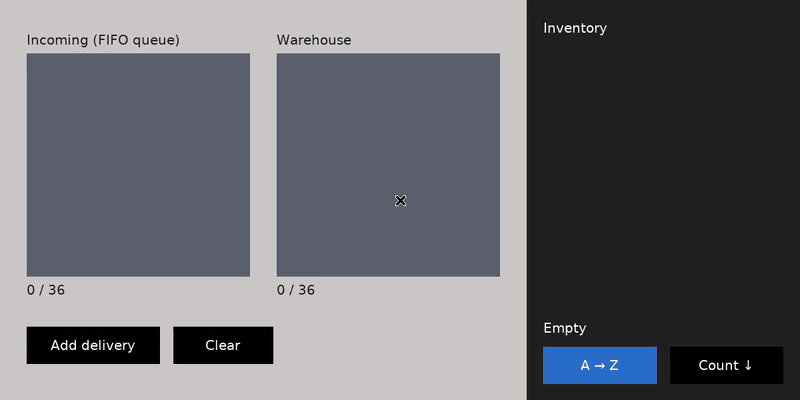

# algo-tri — warehouse sorting visualizer

[](https://github.com/Arno-Dubois/algo-tri/actions/workflows/build.yml)

A small C / SDL2 application that simulates a warehouse and **animates sorting on linked lists**.
Deliveries arrive in a FIFO queue, are unloaded into the warehouse one by one, and the stock is
sorted step by step (bubble sort) either alphabetically or by quantity.



## Features

- **FIFO queue** for incoming deliveries, implemented as a singly linked list with head/tail pointers
- **Inventory** kept as a linked list of `(product, count)` entries
- **Animated bubble sort** that performs one node swap per tick, so you can watch it happen:
  - `A → Z`: alphabetical order
  - `Count ↓`: decreasing quantity, with ties broken alphabetically
- The warehouse cells are regrouped to follow the inventory order
- Capacity limits: items wait on the dock when the warehouse is full, and nothing is lost
- Core logic separated from the UI and covered by unit tests (CTest + CI)

## Build & run

Requirements: a C11 compiler, CMake ≥ 3.16, SDL2 and SDL2_ttf.

**Linux (Debian/Ubuntu)**
```sh
sudo apt install build-essential cmake libsdl2-dev libsdl2-ttf-dev
cmake -S . -B build
cmake --build build
./build/algo_tri
```

**macOS (Homebrew)**
```sh
brew install cmake sdl2 sdl2_ttf
cmake -S . -B build && cmake --build build
./build/algo_tri
```

**Windows (MSYS2 / MinGW64)**
```sh
pacman -S mingw-w64-x86_64-gcc mingw-w64-x86_64-cmake mingw-w64-x86_64-SDL2 mingw-w64-x86_64-SDL2_ttf
cmake -S . -B build -G "MinGW Makefiles"
cmake --build build
./build/algo_tri.exe
```

**Tests**
```sh
ctest --test-dir build --output-on-failure
```

## Controls

| Button | Action |
|---|---|
| Add delivery | Queue 5 random products on the incoming dock |
| Clear | Empty the dock, the warehouse and the inventory |
| A → Z | Sort the inventory alphabetically |
| Count ↓ | Sort the inventory by decreasing quantity |

## Project structure

```
src/
  depot.h / depot.c   Simulation logic: FIFO queue, inventory, incremental sorting (no SDL)
  main.c              SDL2 rendering and input handling
tests/
  test_depot.c        Unit tests for the simulation logic
assets/fonts/         DejaVu Sans (see LICENSE-DejaVu.txt)
```

## Implementation notes

- Swaps relink nodes (`a->next = b->next; b->next = a; *link = b;`) through a pointer-to-pointer,
  so the head of the list needs no special case.
- `depot_sort_step()` returns `false` once everything is in order, which drives the
  "Sorting…" / "Sorted" indicator.
- The simulation runs on fixed timers (`UNLOAD_INTERVAL_MS`, `SORT_INTERVAL_MS`), independent of the frame rate.

## Context

Originally written in 2024 as a C programming project during my engineering studies,
then refactored: logic/UI separation, unit tests, CMake + CI, bug fixes.
